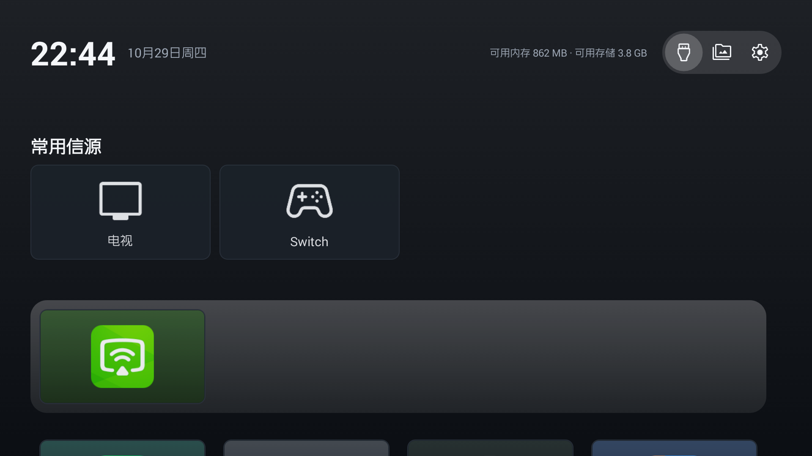

# Luma TV Home

A lightweight launcher for old Android TVs. Built and tested on a SHARP LCD-xxBEL7A-C
(Android 4.4.2, API 19), where the stock launcher is slow, cluttered, and hard to
navigate with a plain D-pad remote.



## What it does

- **One scrolling page.** Top bar → favorite inputs → app dock → all-apps grid.
  Pressing Down keeps scrolling the same page instead of opening a second screen.
- **Input switching.** Reads and switches TV inputs through the Sharp/HiSilicon
  TV API, so a single click moves the TV to HDMI1, the set-top box, or the media
  player. Wrong input? The card already tells you which one is active.
- **App dock.** Up to four pinned apps, always in the same place. The grid below
  lists every other app, sorted by last used.
- **Focus made obvious.** The focused card is fully lit and outlined in white,
  everything else dims. The top-bar icons sit in a translucent capsule that
  highlights the focused segment.
- **Ambient glow.** The background gently picks up the focused app's dominant
  color, then fades out a second after focus leaves the app row.
- **Settings built for a TV.** Default home, media button target, background
  presets, and a shortcut into the factory menu.

## Design notes

The layout follows tvOS more than Android TV: one continuous surface, generous
spacing, no wall of icons. Two deliberate choices:

- Cards are 16:9 tiles with the app icon centered, not bare icons. A bare icon in
  a wide card leaves too much empty space on a 1080p screen.
- The dock is always four slots wide, so its position never shifts as apps are
  pinned or unpinned.

Focus scrolling is handled by a custom `ScrollView` (`TvScrollView`). Android's
default behaviour only guarantees that the focused view is *technically* visible,
which leaves cards flush against the screen edge. This implementation computes the
scroll target from the card's scaled visual bounds plus breathing room, so focused
cards always land in the same comfortable position.

## Compatibility

- Android 4.4 (API 19) and newer. No AndroidX, no AppCompat — just framework views.
- Input switching requires the Sharp TV API
  (`com.sharp.android.tvapi.source.SharpSource`), which ships on the boot
  classpath of Sharp/Hisilicon TV firmware. On other devices the launcher still
  runs; the input cards simply have nothing to switch.

## Build

Requirements: JDK 11+, Android SDK with platform 33 and build-tools 30+.

```bash
# debug build
./gradlew assembleDebug     # or: gradle assembleDebug

# release build (signed with the debug key, installable as-is)
gradle assembleRelease
```

Output: `app/build/outputs/apk/release/app-release.apk`

## Install

```bash
adb install -r app/build/outputs/apk/release/app-release.apk
```

Then press HOME, pick **Luma TV Home**, and choose **Always**.

## Project layout

```
app/src/main/java/com/luma/home/
├── LauncherActivity.java    home screen
├── TvScrollView.java        focus-aware scrolling
├── TvApi.java               Sharp/HiSilicon TV API (reflection)
├── SourceStore.java         input config and defaults
├── SourcePanelActivity.java all inputs
├── SourceEditActivity.java  rename / re-icon an input
├── SettingsActivity.java    settings
├── AppRepo.java             installed apps
├── AppStore.java            pinned apps
├── AppUsage.java            last-used tracking
├── AppArt.java              16:9 card artwork
├── IconLib.java             device icon set
└── Prefs.java               preferences
```
